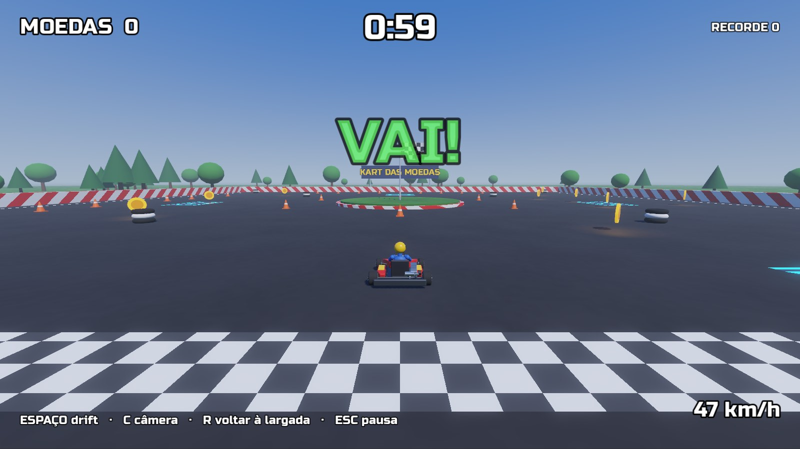
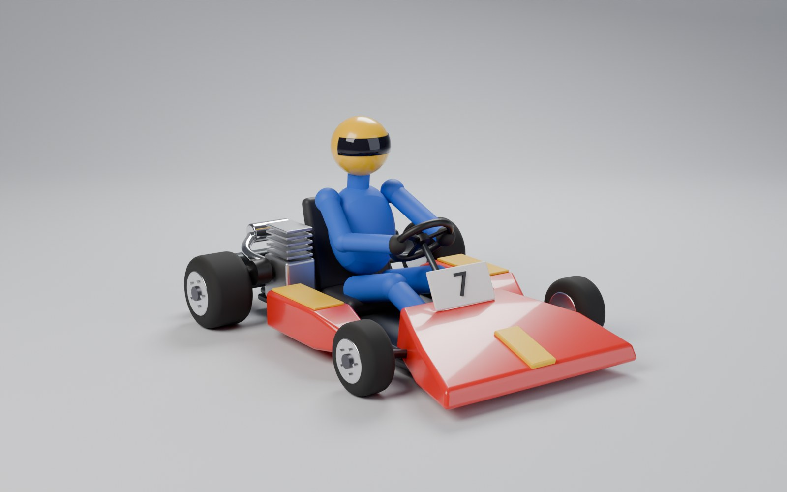
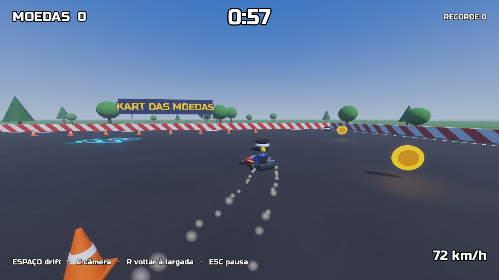

# Computação Gráfica: Trabalhos 1 e 2

**Trabalho 1:** modelagem 3D de um kart com piloto no Blender.
**Trabalho 2:** *Kart das Moedas*, um jogo 3D no Godot que usa o kart modelado no Trabalho 1.



| Trabalho 1: modelo no Blender | Trabalho 2: jogo no Godot |
|---|---|
|  |  |

## Jogar sem instalar nada

Baixe o executável na aba **[Releases](https://github.com/TAIANETERASSAKA/computacao-grafica-kart/releases/latest)**:

- `KartDasMoedas-Windows.zip`: descompacte e abra `KartDasMoedas-Windows.exe`;
- `KartDasMoedas-Linux.zip`: descompacte e rode `./KartDasMoedas-Linux.x86_64`.

**Objetivo:** pegar o máximo de moedas em 60 segundos.
**Controles:** W/S acelera e freia, A/D vira, Espaço é o freio de mão (drift), C troca a câmera, Esc pausa.

## Estrutura

```
Trabalho1-Modelagem/   modelar_kart.py (gera o modelo por script), kart.blend, kart.glb, renders/
Trabalho2-Jogo/        projeto Godot 4.7: cenas, scripts GDScript, shaders, sons, modelo do T1
documentacao/          relatório em PDF, gerar_relatorio.py e imagens
jogar.sh, abrir_godot_editor.sh, abrir_blender.sh   atalhos para Linux (usam a pasta ferramentas/)
```

Cada trabalho tem o seu próprio README com os detalhes:
[Trabalho 1](Trabalho1-Modelagem/README.md) · [Trabalho 2](Trabalho2-Jogo/README.md).

## Documentação

- **Relatório:** [`documentacao/Relatorio_CG_Trabalhos_1_e_2.pdf`](documentacao/Relatorio_CG_Trabalhos_1_e_2.pdf), 20 páginas no formato ABNT.
- Para gerar o PDF de novo (precisa de Python 3 e Google Chrome): `python3 documentacao/gerar_relatorio.py`.

## Ferramentas

| Ferramenta | Versão | Uso |
|---|---|---|
| [Blender](https://www.blender.org/download/lts/4-5/) | 4.5 LTS | modelagem (Trabalho 1) |
| [Godot](https://godotengine.org/download/) | 4.7.2 | jogo (Trabalho 2) |

A pasta `ferramentas/` não vai para o repositório, porque é grande demais. Para usar os atalhos `.sh`, coloque nela:

- `Godot_v4.7.2-stable_linux.x86_64`;
- a pasta `blender-4.5.16-linux-x64/`.

Também dá para abrir os projetos direto no Blender e no Godot instalados no computador.

### Regenerar o modelo do Trabalho 1

```bash
blender --background --python Trabalho1-Modelagem/modelar_kart.py
```

O script cria o `.blend`, o `.glb` e os renders. Depois, copie `kart.glb` para `Trabalho2-Jogo/modelos/`.
