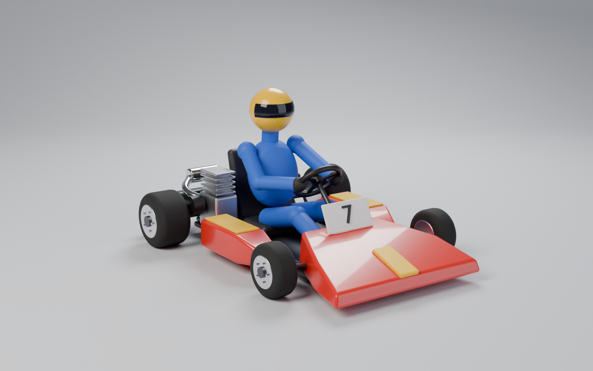
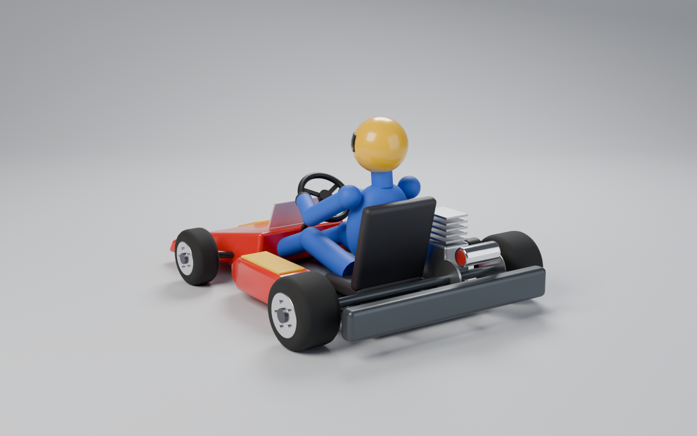
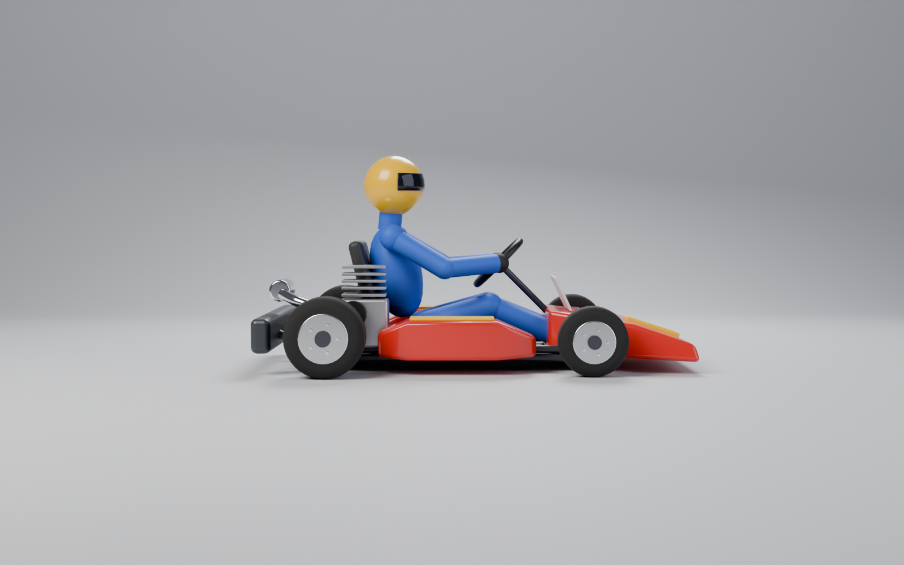
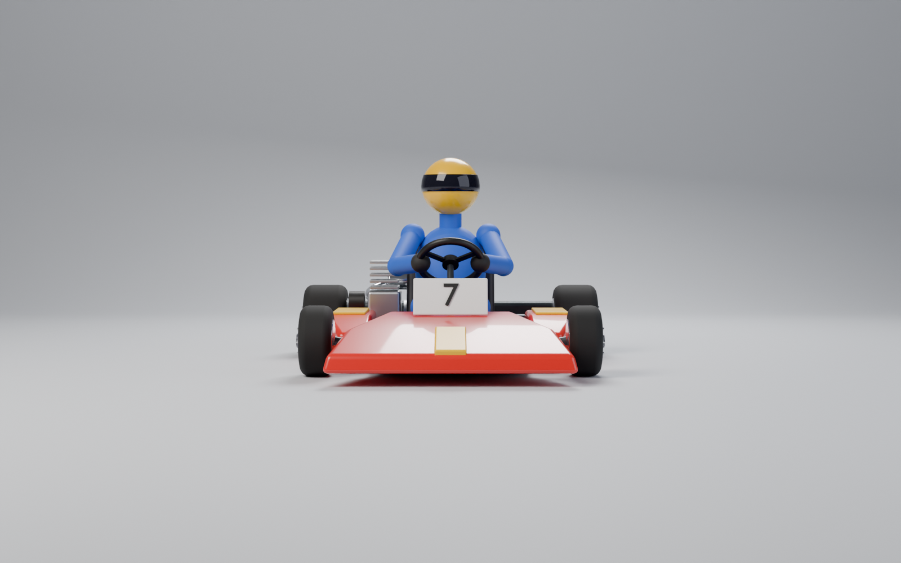
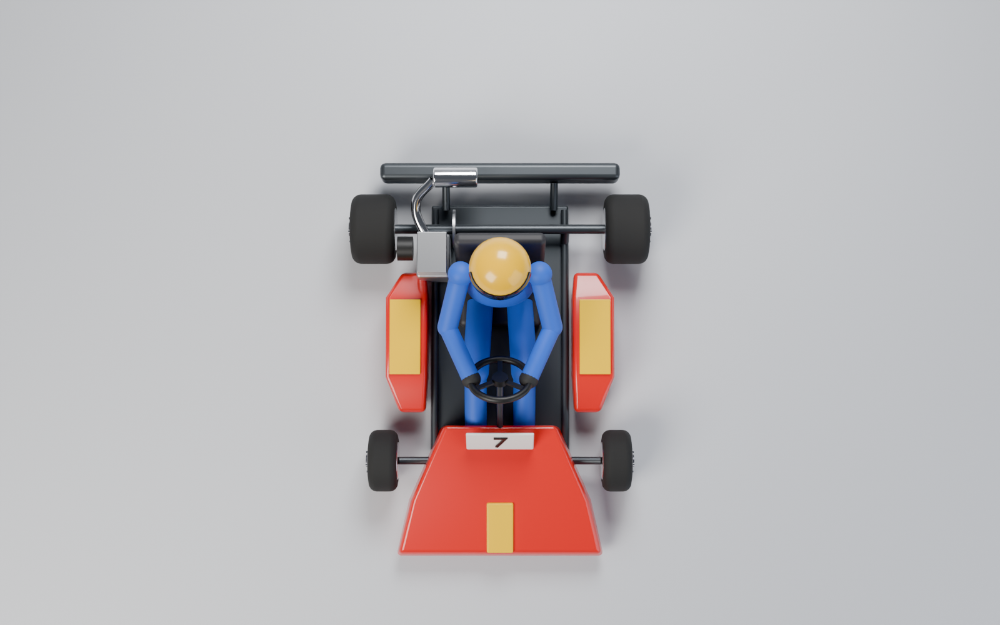
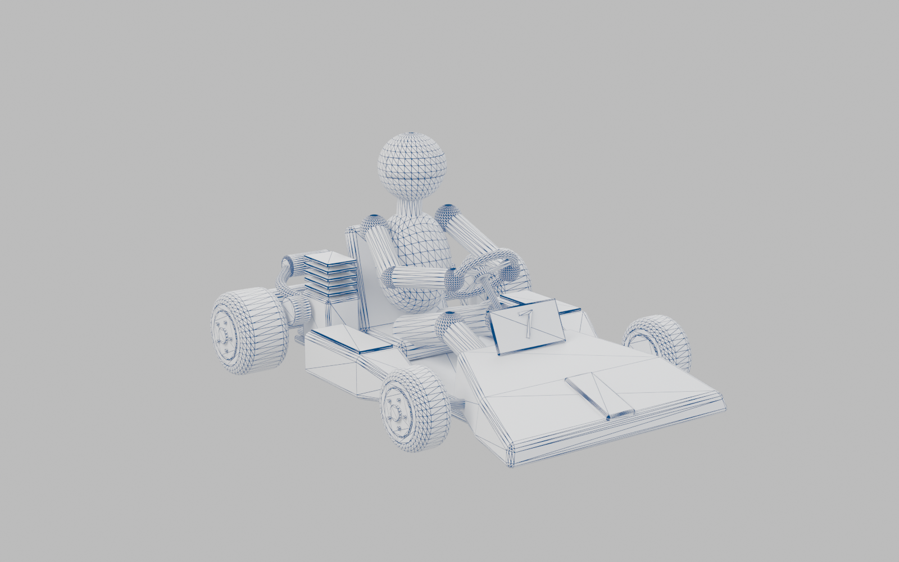

# Trabalho 1 — Modelagem 3D: Kart

Modelo 3D de um **kart de corrida com piloto**, feito no **Blender 4.5 LTS**.
O modelo é usado como personagem principal do jogo do Trabalho 2 (Godot).



## Arquivos

| Arquivo | Conteúdo |
|---|---|
| `kart.blend` | Cena do Blender: modelo, materiais, luzes, câmera e estúdio de render |
| `kart.glb` | Modelo exportado em glTF 2.0 binário (formato usado no Godot) |
| `modelar_kart.py` | Script Python (API `bpy`) que constrói o modelo passo a passo |
| `renders/` | Imagens renderizadas com o Cycles (vistas e wireframe) |
| `estatisticas.json` | Contagem de objetos, vértices, faces e triângulos |

## Peças do modelo

- **Chassi**: assoalho, tubos laterais, eixo traseiro, mangas de eixo e suportes
- **Carenagem frontal** e **laterais** vermelhas com faixas amarelas
- **Para-choque traseiro**
- **Placa de número** com o número “7” em 3D
- **Banco** (assento + encosto)
- **Motor**: bloco, aletas de refrigeração, filtro de ar, coroa, escapamento e silenciador
- **Direção**: coluna e volante (aro, 3 raios e cubo)
- **4 rodas**: pneu, aro, cubo e 5 porcas cada (as traseiras são mais largas)
- **Piloto**: tronco, pescoço, capacete com viseira, braços, luvas, pernas e sapatos

## Técnicas de modelagem utilizadas

| Técnica | Onde foi usada |
|---|---|
| **Primitivas** (cubo, cilindro, esfera UV, toro) | Base de quase todas as peças |
| **Transformações geométricas** (translação, rotação e escala) | Posicionar e orientar cada peça; cilindros orientados por quaternião entre dois pontos (braços, pernas, tubos) |
| **Loft de seções transversais** (malha criada vértice a vértice com `bmesh`) | Carenagem frontal (3 seções) e laterais (4 seções) |
| **Modificador Bevel** (com *harden normals*) | Arredonda as arestas da carenagem, banco, pneus, para-choque etc. |
| **Modificador Mirror** | As laterais e suas faixas são modeladas só do lado direito e espelhadas no eixo X |
| **Modificador Array** | Aletas de refrigeração do motor (1 peça repetida 5 vezes) |
| **Modificador Subdivision Surface** | Tronco do piloto (*box modeling*: uma caixa subdividida vira uma forma orgânica) |
| **Modificador Boolean** (interseção) | Viseira do capacete: interseção de uma esfera com uma caixa auxiliar |
| **Curva Bézier com perfil** (*bevel depth*) | Tubo do escapamento, convertido em malha |
| **Texto 3D** | Número “7” da placa, convertido em malha |
| **Join** (união de malhas) | Volante: aro (toro) + raios + cubo em um único objeto |
| **Coordenadas polares** | Distribuição das 5 porcas de cada roda em círculo |
| **Suavização por ângulo** (*shade smooth by angle*) | Superfícies curvas suaves e arestas vivas preservadas |

## Hierarquia (relação pai → filho)

```
Kart (vazio, raiz)
├── Chassi_*, Carenagem_*, Laterais, Para_Choque_*, Placa_*, Banco_*, Motor_*, Escapamento*
├── Coluna_Direcao, Volante
├── Roda_DE / Roda_DD / Roda_TE / Roda_TD   (vazios no centro de cada eixo)
│   └── _Pneu, _Aro, _Cubo, _Porca1..5
└── Piloto (vazio)
    └── Tronco, Pescoco, Capacete, Viseira, Braços, Luvas, Pernas, Sapatos
```

Cada roda tem um **pivô próprio no centro do eixo**. Por isso, no jogo, as rodas
giram ao andar, as dianteiras esterçam nas curvas e o volante gira junto.

## Materiais (PBR, Principled BSDF)

15 materiais com cor base, metalicidade e rugosidade: carenagem vermelha (com verniz),
faixa amarela, placa branca, número preto, borracha do pneu, aro metálico, cubo,
chassi metálico, banco, alumínio do motor, escapamento cromado, macacão azul,
capacete amarelo (com verniz), viseira fumê e luvas.

## Estatísticas

| Item | Valor |
|---|---|
| Objetos (total / malhas) | 87 / 81 |
| Vértices | 11.229 |
| Faces | 10.699 |
| Triângulos | 22.054 |
| Materiais | 15 |
| Dimensões aproximadas | 1,8 m × 1,3 m × 0,9 m |

## Renderização

- Motor **Cycles** (traçado de caminhos), 48 amostras + *denoising*
- Iluminação de estúdio com **3 luzes de área**: principal, preenchimento e recorte
- Fundo infinito (ciclorama) gerado por código: perfil em L com canto arredondado
- Imagem de wireframe gerada com um material de substituição (nó *Wireframe*)

| | |
|---|---|
|  |  |
|  |  |
|  | |

## Exportação para o jogo

O kart é exportado em **glTF 2.0 (.glb)** com os modificadores aplicados e o eixo Y para cima
(convenção do Godot). A frente do kart aponta para +Y no Blender, que vira −Z no Godot:
justamente a direção “para frente” de um nó 3D no Godot.

## Como abrir e regerar

- Abrir o modelo: abra `kart.blend` no Blender 4.5 ou mais novo.
- Regerar tudo (modelo, .glb e renders):
  ```bash
  blender --background --python modelar_kart.py
  # só o modelo e o .glb, sem renders (mais rápido):
  blender --background --python modelar_kart.py -- --so-modelo
  ```
